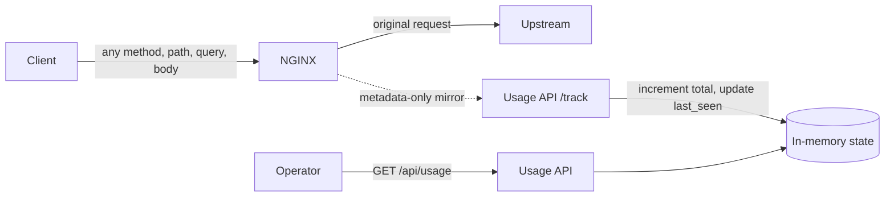

# Architecture

## Purpose

The service is a generic HTTP reverse proxy with a small usage counter. NGINX
forwards requests to an upstream API and mirrors a request to a Go usage API.
The usage API records that a request occurred; it does not parse request content
or store request details as usage state. Its access log includes the HTTP
method and path.

## Components

### NGINX proxy

- Forwards every path and HTTP method to the configured upstream.
- Mirrors each proxied request to the usage API's internal `/track` endpoint.
- Disables request-body mirroring and response buffering, preserving generic
  request forwarding and streaming responses.
- Uses the standard NGINX mirror subrequest: failure to record usage does not
  replace the upstream response.

### Go usage API

The usage API uses only the Go standard library. Its concurrency-safe in-memory
state contains exactly:

- `total`: cumulative number of mirrored requests.
- `last_seen`: timestamp of the most recent request, or `null` before the
  first request.

Its endpoints are:

- `POST /track` — called by NGINX; records one request and returns a small
  acknowledgement. Request content is ignored.
- `GET /api/usage` — returns `{ "total": number, "last_seen": timestamp|null }`.
- `GET /api/healthz` — reports API liveness.

The REST API is served by the usage API, not by a special NGINX route. In the Compose
setup, the API is published on loopback for local inspection and is
also reachable to NGINX over the internal network.

State is not persisted. Restarting the usage API resets `total` and `last_seen`.

### Docker Compose

Compose runs three services:

- `mirror` — the client-facing NGINX proxy.
- `usage-api` — the usage counter and REST API.
- `echo-api` — a generic echo service for local development and smoke tests.

The upstream mock can be replaced by any HTTP service reachable from the
mirror network. Deployment variables and direct `docker run` examples are
documented in the [README](README.md).

## Request flow

The proxy's main request and the tracking subrequest are independent: the
upstream receives the original request, while the usage API only records its
occurrence.

## Design boundaries

- No Ollama-specific routes, model parsing, or endpoint classification.
- No request/response body inspection by the tracker.
- No per-endpoint, per-client, or per-model metrics.
- No database or persistence; the counter is a lightweight usage signal, not
  a system of record.
- The usage API is intended for a trusted internal network; it does not provide
  authentication.

## Verification

Go unit tests cover state, tracking, and response behavior. The Docker Compose
smoke flow checks proxy passthrough and that a mirrored request updates usage.
